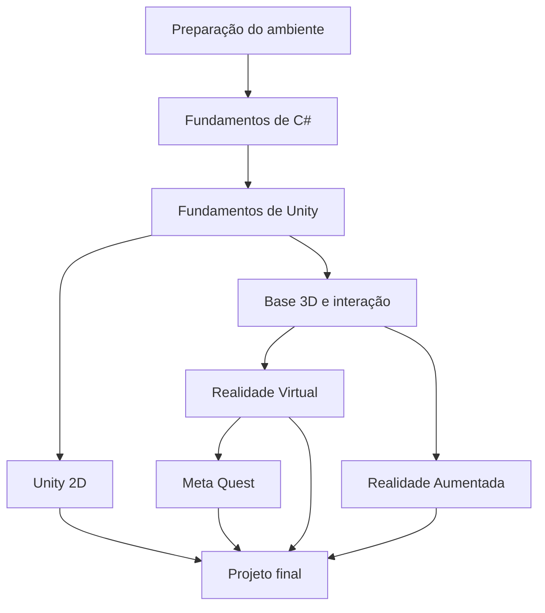

# Trilha de Capacitação — Unity

Aprenda os fundamentos comuns e escolha uma especialização. Unity 2D não é pré-requisito para RV ou RA; Meta Quest aprofunda a ramificação de RV.

## Como seguir

1. Comece pela preparação, C# e fundamentos de Unity.
2. Escolha Unity 2D ou siga pela base 3D até RV ou RA.
3. Para trabalhar com Meta Quest, avance a partir de RV.
4. Conclua com um projeto na área escolhida.

**Situação dos materiais:** todas as páginas abaixo são placeholders, com objetivos e critérios de conclusão. Os tutoriais completos ainda serão adicionados pela equipe LDTT.

## Roadmap interativo

Clique em uma etapa para abrir sua página no HUB. Se o visualizador bloquear os cliques, use a tabela logo abaixo; os links Markdown também funcionam no repositório.

## Etapas e tutoriais

| Etapa | Página do tutorial | Pré-requisito | Situação |
| --- | --- | --- | --- |
| 1 | [Preparação do ambiente](01-preparacao.md) | Nenhum; conhecimentos básicos de uso do computador. | Em elaboração |
| 2 | [Fundamentos de C#](02-csharp.md) | Preparação do ambiente. | Em elaboração |
| 3 | [Fundamentos de Unity](03-fundamentos.md) | Fundamentos de C#. | Em elaboração |
| 4 | [Unity 2D](04-unity-2d.md) | Fundamentos de Unity. | Em elaboração |
| 5 | [Base 3D e interação](05-base-3d.md) | Fundamentos de Unity. | Em elaboração |
| 6 | [Realidade Virtual](06-realidade-virtual.md) | Base 3D e interação. | Em elaboração |
| 7 | [Realidade Aumentada](07-realidade-aumentada.md) | Base 3D e interação. | Em elaboração |
| 8 | [Meta Quest](08-meta-quest.md) | Realidade Virtual e acesso a um dispositivo para validação. | Em elaboração |
| 9 | [Projeto final](09-projeto-final.md) | Concluir uma das ramificações: 2D, RV, RA ou Meta Quest. | Em elaboração |

## Atividade prática

Escolha um projeto pequeno: um jogo 2D, uma cena de RV com objetos manipuláveis ou uma experiência de RA com posicionamento de objetos. Para Meta Quest, execute e valide no dispositivo. Consulte os critérios em [Projeto final](09-projeto-final.md).

## Responsáveis e contribuição

Equipe LDTT. Para sugerir ou desenvolver um tutorial, consulte [Como participar](../../como-participar.md).
